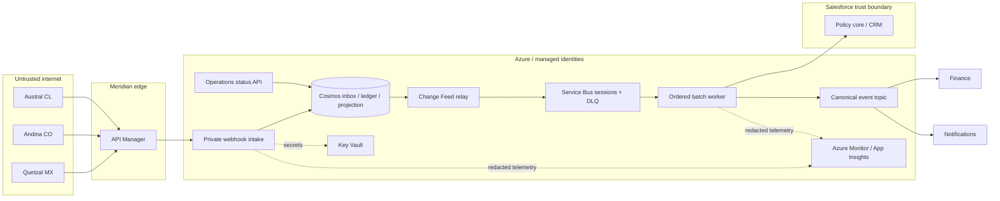
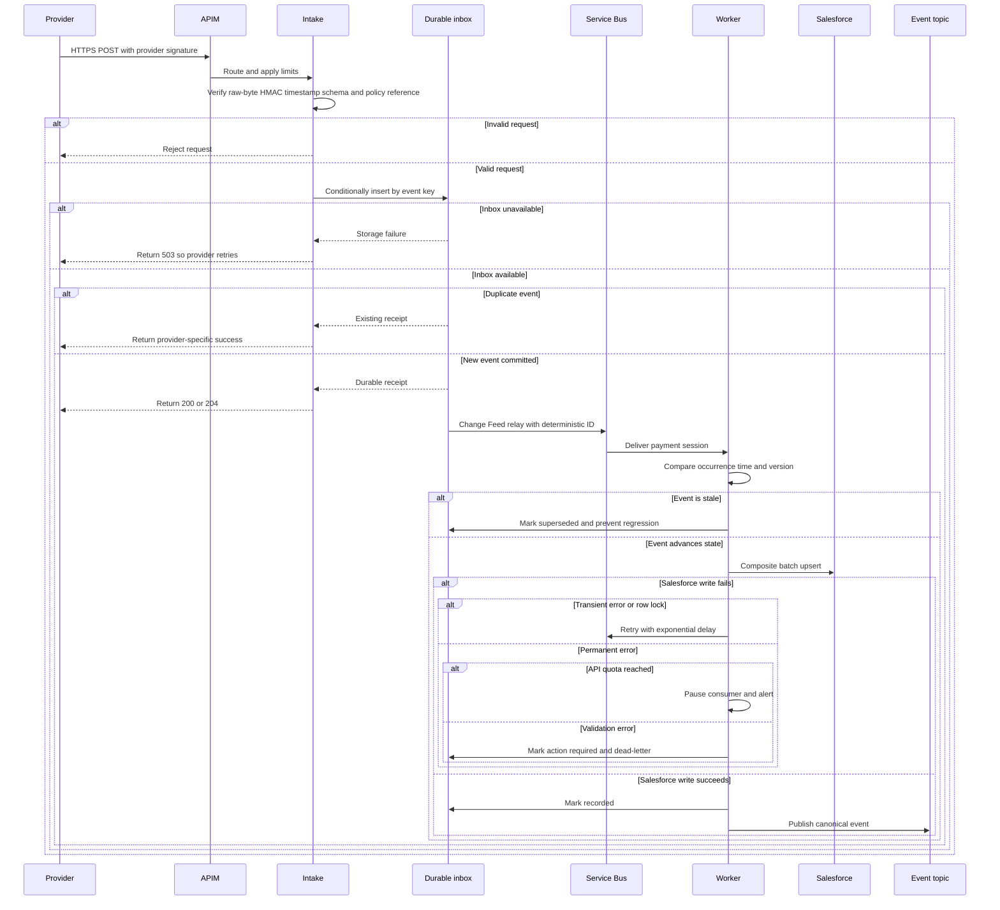

# Premium Payment Notifications — solution design

## Architecture and trust boundaries
The three providers call versioned webhook routes published through APIM. APIM terminates TLS, applies size/rate limits, and routes privately to Java 21/Spring Boot 3 intake on Azure Container Apps. Intake verifies provider HMAC over exact raw bytes, timestamp and schema, then conditionally writes a durable Cosmos DB inbox before acknowledging. Cosmos Change Feed relays at least once to Service Bus Premium sessions partitioned by payment key. Workers maintain an ordered state projection, batch-upsert Salesforce and publish canonical events to Finance/Notifications. APIM is the only public entry; Salesforce is never called point-to-point by providers. Key Vault stores secrets; managed identities have least privilege. Salesforce, provider internet traffic, Meridian Azure and subscribers are separate trust boundaries.

Never log payer names, national IDs, email, payment tokens or raw body. Do not write `Policy__c.Status__c`; Salesforce automation owns reinstatement.

## Sequence and failures

## Canonical event and mappings
Fields: `schemaVersion=1`, stable `eventId`, provider/country, nullable provider event ID, `paymentKey=provider:transactionId`, transaction ID, validated policy number, status (Pending/Captured/Failed/Refunded), decimal-string amount, uppercase ISO currency, provider state-change `occurredAt`, `receivedAt`, opaque correlation UUID, optional source version/reason code and superseded flag. Payer/token fields are excluded.
| Provider | Transition ID / mapping |
|---|---|
| Quetzal MX | Stable `id`; key uses charge ID. charge.succeeded→Captured, charge.failed→Failed, charge.refunded→Refunded; `created` time; centavos→exact decimal MXN, lowercase currency uppercase. Preserve partial refund amount in event history. |
| Andina CO | Attempt ID changes: identity is transaction ID + state + `fecha_transaccion`. PENDIENTE→Pending, APROBADA→Captured, RECHAZADA→Failed, REVERSADA→Refunded; amount exact decimal COP. v2.3 references are payer-entered: validate `POL-CO-NNNNNNNNN`, uppercase only; never guess missing digits. |
| Austral CL | Stable `eventId`; key uses paymentId. PAYMENT_CONFIRMED→Captured, PAYMENT_REJECTED→Failed, PAYMENT_REVERSED→Refunded; occurredAt; integer-string CLP is whole major units. |

## Idempotency, ordering, error handling
Use deterministic `Payment_Key__c=provider:transactionId` as Salesforce external ID. Cosmos conditionally inserts unique transition ID (Quetzal provider+id, Austral provider+eventId, Andina provider+transaction+state+occurredAt). Store immutable event history and a latest projection per payment partition. Later provider occurrence time wins; old messages are marked superseded, never regress; conflicting equal timestamps quarantine. Service Bus sessions serialize by payment key; workers re-read projection and use Cosmos ETag compare-and-swap. Crash after Salesforce success is safe because replay upserts the same external key; reconciler reapplies only latest projection. Publish every unique canonical event, including superseded metadata; consumers dedupe and honor occurredAt.

Salesforce composite upsert at 100 records or 2s, `allOrNone:false`, max 20 concurrent (<25). Cache client-credentials token. Retry 401 once after refresh, 5xx/timeouts/UNABLE_TO_LOCK_ROW with exponential jitter and Retry-After. On `403 REQUEST_LIMIT_EXCEEDED`, pause consumer and circuit-break until budget recovers. Invalid policy/validation 400 is action-required, not hot-loop retried. DLQ holds IDs, correlation, safe error and replay status; no payer data/raw body. Replay has role, audit, freshness check and same idempotent upsert.

## Capacity and freshness
120,000/day; stated burst 40/s for 15 min = 36,000 events. At 100 records/request, peak day is ≈1,200 API calls (0.8% of 150,000 budget); even unbatched 120k is too close, so reserve ≥20% for retry/shared org load. 40/s creates ~40-record batch/s. Target worker 4 requests/s×100=400/s, under 25 concurrency, drains burst in ~90s. At 1.39/s daily average, a 90-min outage queues ~7,500, drained well within 1h after recovery at target. A sustained 40/s outage for 90m adds 216k and exceeds the described daily scenario; alert/escalate. Intake stays available during Salesforce outage. Target intake commit <1s, relay p95 <30s, batch flush ≤2s, Salesforce batch p95 4s; headroom supports p95 ≤5m and 99.5% ≤1h. These are targets to load-test, not measured facts.

## Persistence and FR7
Cosmos stores projection (status, policy, amount/currency, latest occurredAt/version), immutable provider event (event key, IDs, times, correlation, processing status) and relay/outbox state, partitioned by paymentKey. Index provider/event ID and correlation ID through lookup projection. Encrypt, private endpoint, exclude customer data. Provisional encrypted raw-body retention ≤30d and status ledger 13mo pending local privacy approval. Internal status API via APIM/workforce OIDC `Payments.Operations.Read` searches provider/event/transaction/correlation IDs and returns received/recorded/action-required/DLQ/replayed + times; no raw body. Separate replay role `Payments.Operations.Replay`, audit and rate limits. See assumptions.
